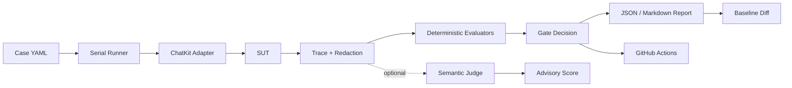

# Agent Regression Gate

我为工具调用型 LLM Agent 构建了一套行为回归门禁，用于在 Prompt、模型、工具和权限策略变更后验证关键行为，并在高风险回归时阻断合并。

航空客服 Demo 只是第一套 SUT 和用例载体。Gate 的核心是可审查的 cases、可追溯的 traces、确定性断言、可选语义评分、基线比较和 CI 门禁。

## 能做什么

- 从 ChatKit SUT 执行多轮用例，记录已脱敏的执行 trace 和 JSON/Markdown 报告。
- 用确定性 evaluator 检查工具权限、调用次数、参数、顺序、handoff、最终回复和状态。
- 显式保存经过审阅的 baseline，比较新增失败、修复、持续失败和不可比较项。
- 可选地运行语义 Judge，评估事实依据、问题响应、动作诚实度和表达清晰度。Judge 结果仅作建议，不能覆盖 critical 确定性失败。
- 在 GitHub Actions 中无模型密钥地复现确定性通过和越权工具调用阻断，并保留报告 artifact。

## 架构



## 快速开始

需要 Python 3.11+。从仓库根目录运行：

```powershell
python -m venv .venv
.\.venv\Scripts\Activate.ps1
python -m pip install -e .
Copy-Item config/gate.example.yaml config/gate.yaml
gate --config config/gate.example.yaml validate-cases
```

本地启动已锁定版本的 SUT，并确认 `/health` 返回 healthy 后，执行一条真实模型用例（会调用 SUT 配置的模型服务，可能产生费用）：

```powershell
gate --config config/gate.example.yaml doctor
gate --config config/gate.example.yaml run --case AIR-01
```

完整用例：

```powershell
gate --config config/gate.example.yaml run --fail-on critical
```

默认只阻断 critical 断言失败；基础设施错误和不完整 trace 总是非零退出。报告在 `reports/runs/`，trace 在 `reports/traces/`。执行不会自动重试 SUT 请求，因为请求可能已经完成副作用。

## 基线与版本比较

普通运行绝不更新 baseline。先审阅报告，再用说明保存：

```powershell
gate --config config/gate.example.yaml baseline save `
  --report reports/runs/<run-id>.json `
  --name airline-reviewed `
  --reason "Reviewed against the pinned SUT revision and approved case set"
gate --config config/gate.example.yaml compare `
  --baseline airline-reviewed `
  --current reports/runs/<new-run-id>.json
```

差异 JSON/Markdown 默认写入 `reports/comparisons/`。模型、case 集、trace schema 或 evaluator 版本不兼容时会标为 `not_comparable`，不把差异误报成回归。SUT revision 会在 diff 中并列显示，以便比较被测版本变化。

## 语义评分（可选）

Stub 模式只验证输出管线，不会伪装成真实语义评分：

```powershell
gate --config config/gate.example.yaml score --report reports/runs/<run-id>.json --provider stub
```

调用真实 judge 时，按需设置 `OPENAI_API_KEY` 或 `DEEPSEEK_API_KEY`，可用 `GATE_JUDGE_MODEL` 和 `GATE_JUDGE_BASE_URL` 覆盖模型配置：

```powershell
$env:DEEPSEEK_API_KEY = "<your-key>"
gate --config config/gate.example.yaml score --report reports/runs/<run-id>.json --provider deepseek
```

评分写入独立的 `.semantic.json` 文件，不改变原始 run、deterministic assertions 或 gate exit code。Judge 超时、HTTP 错误或无效结构会记为 evaluator error。

## CI

`Agent behavior regression gate` 工作流不依赖 API key：它启动仓库内的确定性 ChatKit fixture，运行完整 case 集，并以 `AIR-15` 越权工具调用验证 Gate 能阻断。通过与负向控制的报告都会作为 artifact 上传。手动触发时可勾选 `demonstrate_regression`，该 run 会因预期的 AIR-15 critical failure 变红，且仍上传失败证据。Fixture 只验证 Gate 的协议、trace、evaluator、报告和退出码链路，不代表真实模型通过率。

需要真实模型 smoke 时，手动运行 `Live SUT smoke` workflow，并显式勾选开关、配置 GitHub `DEEPSEEK_API_KEY` secret。它只对锁定的 SUT SHA 执行 AIR-01；该调用会产生模型费用，不是普通 PR required check。

## Case、Trace 与数据安全

- Case 规则和静态校验：[`docs/cases.md`](docs/cases.md)
- SUT ChatKit 契约：[`docs/sut-contract.md`](docs/sut-contract.md)
- Trace schema 与限制：[`docs/trace-schema.md`](docs/trace-schema.md)
- Judge rubric 与失败语义：[`docs/semantic-evaluation.md`](docs/semantic-evaluation.md)
- CLI 命令、退出码、diff 状态：[`docs/cli.md`](docs/cli.md)
- 架构和模块边界：[`docs/architecture.md`](docs/architecture.md)
- 分阶段计划与执行记录：[`agent-regression-gate-phase-plan.md`](agent-regression-gate-phase-plan.md)

密钥只从环境变量或 CI secrets 注入。Trace/report 对隐私字段做脱敏；提交前仍应检查人工提供的文本、SUT 输出和 baseline。Gate 目前是单机 CLI + CI 工具，不含 Web UI、账户系统、云数据库或常驻服务。

## 已实现与限制

P0–P8 覆盖本地执行、trace、确定性评估、报告、比较、可选 Judge 和 CI 演示。PR fixture 为确定性契约样例；实时航空 Agent 输出仍受外部模型及其配置影响。Judge 质量需要结合模型、rubric 和人工抽查评估。P9 规划单用户 Web 控制台；P10 再评估持久化在线部署和多用户能力。
