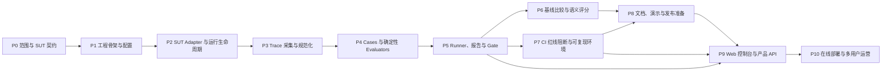

# Agent Regression Gate 分阶段开发计划

> 基于 [`agent-regression-gate-development-plan.md`](./agent-regression-gate-development-plan.md) 重组并细化。本文是执行计划；原开发计划保留为背景材料。
>
> 项目目标：构建一套**证明 Agent 关键行为规则持续成立的评测基础设施**。当前以 OpenAI CS Agents Demo 的航空客服 Agent 作为 SUT（被测系统）载体，项目本身不绑定航空、电商或某一种业务。
>
> 核心评测闭环（P0–P8）按单人约 60–75 小时估算。面向用户的 Web 产品另加 P9；多用户在线服务另加 P10。各阶段可独立验收，工时均为估算。

## P0 执行进度（2026-11-08）

已完成本地 SUT 的许可证、分支与 commit、启动/健康检查、ChatKit 调用、状态快照和首批风险映射核验。核验材料见 [`docs/sut-contract.md`](./docs/sut-contract.md)、[`docs/initial-risk-map.md`](./docs/initial-risk-map.md) 和 [`config/sut.lock.yaml`](./config/sut.lock.yaml)。本地真实会话成功记录了 handoff、`flight_status_tool` 调用、工具输出和最终消息。

**核验补充：** 随后已从远端 refs 确认 `LiangChase/agent-regression-gate` 的 `SUT` 指向锁定 SHA `b4fa4678cd0bace97981ed33e4e2f31acd379c8f`，P0 的本地及远端版本核验均已完成。

## P1 执行记录（2026-11-08）

已建立可安装的 `src/` 包结构、配置样例和层级配置入口、错误分类、Run/Case/Trace/Assertion/Gate 数据模型、带 run/case 关联字段的 JSON 日志与脱敏，以及 `gate config-check` CLI。补充了架构图、目录职责文档和本地敏感文件/报告忽略规则。没有为 Gate 预设开源许可证。

**验收评估：** 本地 editable install 成功；`gate --help` 可用；example YAML 能通过校验；环境变量覆盖 YAML、CLI 覆盖环境变量；无配置文件返回配置错误码 2；结构化日志包含 run/case ID，测试用 dummy key 和带凭据/query 的 URL 在日志/错误对象中均被脱敏；源码 `compileall` 通过。`run`、`validate-cases` 仍属于后续阶段，`doctor` 已在 P2 实现。

## P2 执行记录（2026-11-08）

已实现 ChatKit SSE adapter、thread/session 边界、状态快照读取、SUT health/doctor 诊断，以及本地进程/Compose 生命周期抽象。adapter 保留未知事件和额外字段供后续 trace 层处理；SUT 版本与接口限制见 `docs/sut-adapter.md`、`docs/sut-contract.md`。真实 SUT 调用已在 P3 集成样例中再次验证。

## P3 执行记录（2026-11-08）

已实现版本化的 Gate Trace 与 raw snapshot envelope、按 SUT 快照顺序规范化事件、累计快照去重、turn/thread 关联、采集完整性和 tool trace 状态、敏感字段/文本脱敏、字符串截断、大小限制，以及每 case 原子 JSON 持久化和版本校验。配置通过 `trace.*` YAML 项和 `GATE_TRACE_*` 环境变量控制；设计与事件映射见 [`docs/trace-schema.md`](./docs/trace-schema.md)。

真实 SUT 的航班状态查询已生成脱敏样例 [`AIR-01.trace.json`](./docs/examples/sample-airline-status-20261108/AIR-01.trace.json)：样例包含 handoff、业务工具调用/结果、消息、context update 和 guardrail；raw snapshots 已保存且经过同一脱敏器。API key、thread/request ID 及未使用的敏感字段均未保存为可识别原值。SUT 源端对部分 AgentEvent 文本已有约 200 字符截断，Gate 无法恢复源端已丢弃内容；该限制已写入 trace 元数据与说明。

**验收评估：** 本地样例 JSON 可读回，schema version、采集状态、工具轨迹状态、事件类型、原始快照数量和样例中的 key/email 字符串模式均已核对。当前仓库 `.venv` 指向已不存在的 `C:\Python314\python.exe`，因此本轮无法用该虚拟环境完成 compile/config-check；需修复或重建开发环境后补跑。P3 只交付采集数据模型与存储层，尚未提供 case runner/CLI 执行入口；P4/P5 将接入 cases 与实际执行流程。P3 不引入云数据库，当前本地/CI 文件型报告存储满足单用户阶段需求。

## 1. 目标、范围与完成定义

### 1.1 项目最终要证明什么

每次被测 Agent、Prompt、模型、工具或权限策略发生变化时，系统可以：

1. 读取有版本、可审查的行为用例。
2. 以固定配置调用被测 Agent，并记录可追溯的执行轨迹。
3. 用确定性规则验证工具、参数、顺序、次数、权限和最终状态等关键约束。
4. 可选地对自然语言质量做语义评分，但不让语义评分覆盖硬性安全红线。
5. 与基线结果比较，区分新增失败、已修复失败、持续失败和不可比较项。
6. 在 CI 中对关键回归返回非零状态、阻断检查，并保留报告供定位。

### 1.2 明确不作为项目目标的内容

- 不重新实现航空客服 Agent，也不把业务逻辑搬进 Gate。
- P0–P8 核心评测阶段不做通用 Agent SDK、Web 管理台、租户系统、在线监控或分布式任务平台；产品 Web 控制台放在 P9，多用户能力放在 P10。
- 不把 LLM Judge 的主观分数作为工具权限或安全行为的唯一判据。
- 不在普通 Pull Request 中依赖付费模型 API 才能完成核心门禁。

### 1.3 完成定义（DoD）

**核心评测闭环（P0–P8）：** 一个不了解项目的人按 README 操作，可以在干净环境中启动或连接 SUT，运行至少 15 个有意义的行为用例，检查实际 trace，获得 JSON 与 Markdown 报告；故意制造 critical 回归时，CI 检查失败且仍上传报告；修复后重新运行能通过。

**可使用的 Web 产品（P9）：** 用户无需 CLI 即可浏览 cases/runs、启动评测、查看 trace 与差异、下载报告；应用重启后历史结果仍可读取，UI 与 CI 对同一结果给出一致判定。

**多用户在线服务（P10）：** 在 P9 基础上具备认证、用户/组织数据隔离、后台任务持久化、Secret 管理、备份和监控，可按目标用户范围稳定访问。

## 2. 当前基线与 SUT 接入事实

### 2.1 当前项目状态

- P1 工程骨架、P2 SUT adapter/lifecycle、P3 trace 规范化与持久化已实现；P4 cases/evaluators、P5 runner/report/gate、P6 比较/judge、P7 CI、P8 文档演示尚待开发。
- 当前交付路线先形成 CLI + CI 的核心评测闭环；用户明确希望继续做 Web 前端，因此新增 P9 产品 UI/API，P10 在线产品部署与多用户能力仍需按目标用户确定范围。
- SUT 是 `OpenAI CS Agents Demo`，航空客服场景只作为第一套样例用例。
- 目前已有一次人工启动和请求验证记录；这不能替代可重复的自动化集成测试。
- SUT 对应版本应在开始实现时重新核实并锁定到 commit SHA。当前参考版本：`b4fa4678cd0bace97981ed33e4e2f31acd379c8f`。CI 不应跟随一个会移动的分支尖端。

### 2.2 已知 SUT 接口与限制

| 项目 | 当前观察 | 对 Gate 的影响 |
|---|---|---|
| 调用入口 | FastAPI 提供 `/chatkit`，采用 ChatKit 协议；另有健康和状态接口 | 需要独立 HTTP/ChatKit adapter，不能假设是简单的 JSON 问答接口 |
| 轨迹 | `/chatkit/state?thread_id=...` 可读取事件快照；事件包括消息、handoff、tool_call、tool_output，工具元信息中有参数和输出 | 每条 case 执行后尽快抓取并保存快照；解析过程要校验事件完整性 |
| 状态存储 | 当前主要使用进程内存，重启后会丢失 | 用例之间要创建新 thread，或明确重启/清理策略；报告必须保存原始快照 |
| 模型配置 | SUT 支持通过环境变量选择 DeepSeek 配置；其他环境可能走 OpenAI 配置 | API Key 从环境变量或 CI Secret 注入，不得写入仓库、case、报告或日志 |
| 复现性 | 外部模型输出存在随机性，模型服务不可作为每次 PR 门禁的唯一依赖 | 第一阶段核心门禁优先用可控模型/脚本化替身；真实模型 smoke 测试独立运行 |
| 部署 | SUT 是独立项目目录，Gate 需负责启动、等待健康、收集日志和关闭 | adapter 与 lifecycle 管理分层；CI 明确检出被锁定的 SUT 版本 |

以上为当前已知事实，进入 P0 后需实际检查接口、事件字段和锁定版本；若代码有变动，以现场验证和保存的契约为准。

## 3. 阶段依赖总览



P0–P5 组成最小可用的 CLI 本地闭环，P7 形成 CI 回归门禁。P9 在评测 API 和报告稳定后提供无命令行操作的前端；P10 才处理持久在线服务、多用户和生产运维。P6 的语义评分可以在核心门禁稳定后实现，不得拖延 P5/P7。

## 4. 阶段计划

### P0 — 范围冻结与 SUT 契约核验（4–6 小时）

**目标：** 把“可以测什么、如何调用、哪些轨迹可信”变成明确契约，避免后续按猜测写 adapter。

**任务模块**

1. **版本与许可记录**
   - 记录 SUT 仓库地址、许可证、锁定 commit SHA、Gate 与 SUT 的目录关系。
   - 确认在项目展示中保留 SUT 的许可证、版权声明和来源说明。
   - 记录 Gate 自身的许可证选择待办；不要把 SUT 许可证误当成 Gate 许可证。
2. **运行入口核验**
   - 记录后端安装、启动命令、端口、健康探针、启动超时和关闭方式。
   - 分别验证健康请求、一次普通对话请求、一次带工具调用的请求。
3. **Trace 契约核验**
   - 保存真实状态接口响应样本，识别 event ID、类型、时间、thread、工具名、参数、结果和错误字段。
   - 检查状态接口在请求完成前后是否可能暂时不完整，确定轮询与超时策略。
   - 列出无法从当前 SUT 观测的行为，避免对这些行为写虚假的断言。
4. **用例范围映射**
   - 将航空客服能力映射到风险规则，例如查询航班、改签/取消、行李或特殊服务、人工转接等；只纳入 SUT 实际支持或可明确模拟的能力。
   - 为每条拟测规则标记风险级别、所需工具、证据来源和可观测性。
5. **模型与成本策略**
   - 定义本地/CI 默认使用的确定性执行模式，以及可选真实模型 smoke 模式。
   - 密钥只由环境变量或 CI Secret 注入；报告进行敏感字段脱敏。

**交付物**

- `docs/sut-contract.md`：启动、调用、trace 样例、限制和版本信息。
- `config/sut.lock.yaml`：SUT 仓库与固定 revision（如采取 Git checkout 方式）。
- 初始风险规则清单，以及待验证项列表。

**验收条件**

- 新开发者可以按文档启动 SUT，并拿到一份包含真实 tool_call 的状态快照。
- 一条 trace 能关联到对应用户输入和 thread。
- 确定性模式与真实模型模式的区别、密钥来源、不可观测项均已记录。

**依赖/风险：** 如果状态接口没有足够参数/结果字段，P3 前先设计 SUT 薄埋点或替代观测方案；埋点必须单独记录 patch 与版本，不能静默改变业务规则。

### P1 — Gate 工程骨架、配置与错误模型（6–8 小时）

**目标：** 建立简单、可安装、能在本地和 CI 使用的 Python 项目骨架。

**任务模块**

1. **目录与包结构**
   - 建立 `src/agent_regression_gate/` 包和 `pyproject.toml`。
   - 划分 `config`、`sut`、`tracing`、`cases`、`evaluators`、`execution`、`comparison`、`reporting`、`cli` 模块。
   - 建立 `cases/`、`reports/`、`baselines/`、`docs/`、`scripts/` 的职责说明。
2. **统一配置入口**
   - 支持命令行参数、环境变量、YAML 配置，明确优先级。
   - 配置 SUT base URL、启动方式、健康探针、超时、输出目录、case 集、模型模式。
   - 启动时校验必填配置，错误提示指出具体变量名，但不回显密钥值。
3. **统一数据模型与错误分类**
   - 定义 `Run`、`CaseResult`、`Trace`、`AssertionResult`、`GateResult` 的最小字段。
   - 区分配置错误、SUT 不可用、协议错误、trace 不完整、断言失败和内部错误。
   - 为每个 case、run 生成稳定 ID/关联 ID，方便日志、trace、报告串联。
4. **可观测日志**
   - 采用结构化日志，默认不记录 API Key、完整隐私字段或无关请求头。
   - 记录 run ID、case ID、耗时、SUT 地址和错误类别。

**交付物**

- 可安装的 Python 包、统一配置、初始数据模型和 CLI 占位命令。
- `.gitignore` 覆盖环境文件、密钥、本地报告和临时 SUT 数据。
- `docs/architecture.md` 的模块职责草图。

**验收条件**

- `--help` 显示清楚的运行入口。
- 缺少配置时快速失败并提供修复提示。
- 日志和错误输出不泄露环境变量中的密钥。

### P2 — SUT Adapter 与生命周期管理（8–10 小时）

**目标：** 将 SUT 的启动/等待/调用/清理封装成统一、可替换的边界。

**任务模块**

1. **Adapter 接口**
   - 定义统一操作：`health_check()`、`create_session()`、`send_turn()`、`fetch_trace()`、`close_session()`。
   - 方法返回 Gate 自己的数据对象，不让 ChatKit 原始协议扩散至 evaluator。
   - 统一超时、重试边界、HTTP 错误映射和请求关联 ID。
2. **ChatKit 实现**
   - 封装 `/chatkit` 所需请求格式、流式响应读取和 thread/session ID 管理。
   - 封装 `/chatkit/state` 等状态接口，等待目标交互的事件进入快照。
   - 对未知事件类型保留原始字段，解析失败时明确报告，不静默丢事件。
3. **进程生命周期**
   - 支持连接已启动的 SUT；本地开发可选由 Gate 启动子进程或 Compose 服务。
   - 执行前等待健康；超时则输出 SUT stdout/stderr 的脱敏尾部日志。
   - 运行结束后清理子进程和临时文件，支持异常中断清理。
4. **会话隔离**
   - 每个 case 默认新建 thread，避免上一条 case 的上下文污染下一条。
   - 若场景需要多轮交互，则在同一 case 内共享 thread，并按 turn 顺序记录。
   - 定义失败重试规则：非幂等交互不能无条件重试，防止重复执行工具。

**交付物**

- `sut/base.py`、`sut/chatkit_adapter.py`、`sut/lifecycle.py`。
- 可手动运行的连接诊断命令，例如 `gate doctor`。
- 一份脱敏的成功/失败协议样例。

**验收条件**

- Gate 可以连接 SUT，提交一轮输入并取回相同 thread 的 trace。
- SUT 未启动、响应超时、协议异常、trace 尚未生成能得到不同且可理解的错误。
- 一个 case 的 thread 不会意外复用到另一个 case。

## P2 实施记录（2026-11-08）

已实现 `SutAdapter` Protocol、ChatKit HTTP/SSE adapter、会话和快照数据对象、request ID、SUT lifecycle（external/process/compose）以及 `gate doctor`。Adapter 解析 ChatKit SSE 完成状态，通过 bootstrap 建立 thread，通过 state API 读取 AgentEvent/guardrail/context；未知事件类型和额外字段会保留给 P3，workflow/reasoning 文本不会被 adapter 保存。对话请求不自动重试。

**核验结果：** `gate doctor` 通过配置启动本地后端、等待 `/health` 返回 200 并清理进程；实际 ChatKit 查询完成，状态快照与 session thread 匹配，轨迹含 `handoff → flight_status_tool → tool_output → message → context_update`，工具参数为 `FLT-123`。本地协议模拟还验证了未知事件保留、session 关闭后拒绝继续调用、无 assistant 完成事件时标记 `trace_incomplete` 和请求关联 ID。SUT 不可达时 `doctor` 返回退出码 3 和 `sut_unavailable`。

**边界记录：** 当前 SUT 没有 thread 删除接口，`close_session` 仅关闭 Gate 侧句柄；服务内存中的 thread 仍保留至 SUT 进程结束。`process` 模式只管理直接子进程；需要清理进程树/多服务时使用 `compose`。P3 仍需负责将输入、turn 边界和 snapshot 持久化并做隐私脱敏。

### P3 — Trace 采集、规范化与持久化（8–10 小时）

**目标：** 将 SUT 原始事件变成可审查、可比较、可长期保存的执行证据。

**任务模块**

1. **原始与规范化双层存储**
   - 保存原始 API 快照，便于排查 adapter 解析问题。
   - 规范化为统一事件：`message`、`handoff`、`tool_call`、`tool_result`、`error` 等。
   - 不丢失未知原始事件；规范化字段缺失时记录 `unknown`/`missing`，不能伪造成功。
2. **Trace schema**
   - 至少包含 `run_id`、`case_id`、`sut_revision`、`thread_id`、`started_at`、`ended_at`、有序事件列表、完成状态和采集来源。
   - 工具事件包含工具名、结构化参数、工具结果摘要/结构化结果和关联 event ID（若 SUT 提供）。
   - 记录模型名/模式、adapter 版本和 case 版本，支持结果可比较性判断。
3. **完整性与顺序**
   - 定义必需事件和完成判定；空快照或只有最终回答不能被误认为完整工具轨迹。
   - 尽可能保留 SUT 顺序；时钟字段不可信时以返回顺序为准并在 schema 标注。
   - 多轮会话把 turn 序号和事件顺序分开表示。
4. **脱敏与安全**
   - 对 Authorization、密钥、邮箱、电话等按策略脱敏。
   - 对超长工具输出设置摘要/大小限制，同时原始数据是否保存由本地配置控制。
   - 报告默认不展示敏感请求头和环境变量。
5. **持久化格式**
   - 每个 run 写独立 JSON 文件或 JSONL，采用 schema version。
   - 写入使用原子方式，避免中断留下可被误当成完整的报告。

**交付物**

- `tracing/schema.py`、`tracing/normalize.py`、`tracing/storage.py`、`tracing/redaction.py`。
- 一份真实 SUT 的脱敏原始快照和规范化 trace 示例。
- Trace schema 文档及版本升级约定。

**验收条件**

- 可以从持久化记录中还原每次 case 的输入、工具调用、参数、结果和最终响应。
- trace 缺事件、解析失败、服务仍未完成时明确失败或标为 incomplete。
- 输出文件中无 API Key，JSON 可独立读取并包含 schema version。

### P4 — Cases 数据集与确定性 Evaluators（10–12 小时）

**目标：** 让行为规则成为可审查、稳定 ID、与业务代码分离的数据，并先完成可重复判定的硬规则。

**任务模块**

1. **Case schema 与加载器**
   - 每个 case 包含稳定 `id`、名称、风险级别、标签、前置状态、用户 turn、规则、超时、预期证据和描述。
   - 支持单轮和多轮输入；支持参数化数据，但报告保留每个具体执行实例。
   - 加载时校验重复 ID、未知 evaluator、缺失必填字段和不合理阈值。
2. **航空客服首批用例**
   - 按 SUT 已有工具和实际能力选取场景，不虚构系统支持的退款/预订能力。
   - 目标至少 15 条，按风险和规则组合覆盖：航班状态查询、行李/服务查询、人工转接、工具参数完整性、无关请求拒绝、无工具情况下不得编造结果、多轮上下文隔离等（具体项以 P0 契约核验为准）。
   - 如果某种高风险规则在 SUT 中没有对应动作或可观测事件，标为未来扩展，不计入已覆盖数量。
3. **规则类型**
   - `tool_must_be_called` / `tool_never_called`。
   - `tool_call_count`：次数上下限和重复调用检测。
   - `tool_args_match`：必填字段、枚举、正则或明确字段谓词。
   - `tool_order` / `handoff_required`：有序工具行为或转人工要求。
   - `final_response_contains` / `final_response_not_contains`：仅用于稳定、低歧义文本约束。
   - `trace_complete` / `final_state`：轨迹或状态必须满足前置定义。
4. **断言结果模型**
   - 每条断言输出 `passed`、实际证据、期望值、失败原因和定位 event ID。
   - critical 规则失败即 case fail；warning/info 仅记录，策略集中配置。
   - 同一失败保持稳定错误码，方便 diff 和 CI 摘要。

**交付物**

- `cases/` 中可读的 YAML/JSON 用例文件和 schema 文档。
- `cases/loader.py`、`evaluators/deterministic.py`。
- 至少 15 条有效用例及其规则到风险的映射表。

**验收条件**

- 修改一条 case 不需要修改 runner 代码。
- 每条 critical 断言都能指出对应 trace 证据或缺失证据。
- 无法观测的行为不会被标为已覆盖；case 加载错误可在执行前发现。

### P5 — 执行 Runner、报告与 Gate 判定（8–10 小时）

**目标：** 把 case、adapter、trace 和 evaluator 串成完整、可重复、本地可用的命令。

**任务模块**

1. **Run 编排**
   - 根据标签/ID/风险级别筛选 cases，确定执行顺序和并发策略。
   - MVP 默认串行，避免 SUT 内存状态、模型限额和共享资源造成相互干扰。
   - 每条 case 执行前准备会话，完成后抓 trace、评估、保存结果；单条失败后仍继续执行其余用例（基础设施故障可配置停止）。
2. **Gate 策略**
   - 区分 `PASS`、`FAIL`、`ERROR`、`INCOMPLETE`；报告要区分行为回归与基础设施故障。
   - critical 失败和 critical trace incomplete 返回非零；非关键失败按策略处理。
   - CLI 退出码及其意义写入文档，确保 CI 能直接使用。
3. **JSON 报告**
   - 汇总 run 元信息、SUT revision、配置摘要、用例统计、断言统计、每条 case 结果和 trace 路径。
   - 保持 schema version，供下一阶段比较。
4. **Markdown 报告**
   - 展示总结果、失败 case、失败规则、期望/实际、trace 定位、耗时和修复建议线索。
   - 失败摘要放在最前；成功报告同样展示覆盖量和警告。
5. **命令行入口**
   - 提供核心命令：`gate run`、`gate doctor`、`gate validate-cases`。
   - 提供 `--output`、`--case`、`--tag`、`--mode`、`--fail-on` 等必要参数。

**交付物**

- 可运行的 `execution/runner.py`、`comparison/gate.py`、`reporting/` 和 CLI。
- 示例 JSON/Markdown 报告。
- 一条本地命令完成核心用例运行并返回 gate 状态。

**验收条件**

- 成功运行产出 JSON 与 Markdown；critical 失败时命令返回非零并报告仍完整写出。
- SUT 无法启动时结果明确显示 ERROR，而不是误报行为 FAIL 或 PASS。
- 同一代码、配置和 SUT revision 下，结构化断言结果可解释且可复现；随机自然语言差异不会无故改变硬规则结论。

### P6 — 基线比较与可选语义评估（6–8 小时）

**目标：** 展示版本变化影响，并补充适合自然语言输出的质量评估；这阶段不改变确定性红线优先级。

**模块 A：基线与差异**

- 保存经人工确认的 baseline JSON，并记录 case 集、SUT revision、模型配置、Gate 版本和生成时间。
- 计算新增失败、已修复、持续失败、结果变化、用例新增/删除和不可比较项。
- 结果比较前校验模型、case 版本、trace schema 和 evaluator 版本；关键维度不同则标记 `not_comparable`，不伪装成改善/退化。
- baseline 更新需显式命令和审阅说明；普通 run 不覆盖基线。

**模块 B：语义评分**

- 定义 rubric：事实依据、是否回答问题、是否承诺未执行动作、语气/清晰度等；每项有分值和判定说明。
- 评分器作为独立 evaluator 接口，可接真实 judge 或本地 stub；记录 judge 模型、rubric 版本、输入证据和原始结构化判定。
- 默认只提供评分/趋势，或只对配置的低风险维度设阈值；不得把“回答听起来合理”用于豁免未授权工具调用、缺失工具证据等 critical 失败。
- judge 超时/解析失败标为 evaluator error，不默认为通过。
- 真实 judge 网络调用默认不进入普通 PR 必需检查，避免成本与随机性令主门禁不稳定。

**交付物与验收**

- `comparison/diff.py`、baseline 格式和比较命令。
- `evaluators/semantic.py` 及 rubric 示例（如本阶段时间不足，先实现接口和 stub，文档明确未接真实模型）。
- 两份 run 结果能正确展示新增失败和已修复项；不可比结果有明确原因；baseline 不会被自动覆盖。

### P7 — CI 红线阻断与执行环境固定（8–10 小时）

**目标：** 将本地门禁变成可展示、能阻断的 Pull Request 检查。

**任务模块**

1. **依赖与版本固定**
   - 选定支持版本的 Python，并锁定 Gate 依赖；SUT 使用锁定 revision 和自身依赖策略。
   - 不依赖开发者本地 `.env`、未提交文件或个人模型额度才能通过默认 PR 流程。
2. **工作流设计**
   - checkout Gate 分支，并单独 checkout `sut.lock.yaml` 指定的 SUT revision（或使用已发布、哈希固定的镜像）。
   - 安装依赖、启动 SUT、等待健康、运行 critical suite、上传报告与日志摘要。
   - 报告 artifact 使用 `if: always()` 语义，保证 gate 失败仍可下载诊断材料。
   - 为真实模型 smoke 建独立手动/定时工作流，密钥只放 GitHub Secrets，默认不作为普通 PR 必须项。
3. **失败策略与摘要**
   - critical 行为回归令 job 失败；基础设施故障同样阻止但显示不同分类和排查建议。
   - 在 job summary 中列出失败 case、失败规则、trace/report artifact 路径。
4. **阻断演示**
   - 制作可切换的演示回归（例如期望工具不调用却触发工具，或关键调用次数超限），确认 CI 因行为断言失败。
   - 恢复正确行为后重新执行通过；记录两次 run 链接或截图供作品集展示。

**交付物**

- `.github/workflows/` 下的 PR gate 工作流和可选模型 smoke 工作流。
- 固定的 SUT revision 和依赖说明。
- 成功与失败的 CI 记录、报告 artifact、失败摘要。

**验收条件**

- 在 CI 环境可自动启动 SUT 并完成默认核心用例。
- 注入演示回归后 required check 返回失败，报告 artifact 仍然存在。
- 恢复后检查通过；没有密钥的普通 PR 仍可运行核心门禁。
- SUT 或 Gate 的版本变化能从报告中追溯。

### P8 — 文档、可复现演示与发布准备（5–7 小时）

**目标：** 让项目可被面试官或协作者快速理解、运行、审查。

**任务模块**

- README 先说明问题、系统边界、数据流、SUT 与 Gate 的关系，再提供最短运行命令。
- 维护架构图：case → runner → adapter → SUT → trace → evaluator → gate/report → CI。
- 写快速开始、配置说明、SUT 契约、用例新增指南、错误排查、baseline 更新、语义评分边界和安全说明。
- 在 README 中明确“已实现”和“后续计划”，只陈述可由运行记录或代码验证的能力。
- 准备 3–5 分钟演示：展示用例、trace 证据、确定性失败、CI 阻断、修复后通过和 baseline diff。
- 生成简历项目描述时只填真实用例数、真实运行次数和真实阻断证据，不将目标数字写成成果。

**验收条件**

- 干净环境按 README 可完成一次成功运行和一次失败演示。
- README 命令与实际 CLI 一致，报告样例为真实生成或清楚标注为示例。
- 许可证、SUT 来源、配置密钥方式和系统局限交代清楚。

### P9 — Web 控制台与产品 API（约 30–45 小时，核心链路完成后）

**目标：** 让用户能通过浏览器管理评测任务、启动运行、查看证据和比较结果；CLI 保留为本地开发和 CI 入口。前端不直接连接 SUT，也不在浏览器中保存模型密钥。

**建议的首版结构**

- 前端：Next.js + TypeScript，独立目录 `web/`。该选型与当前 SUT 的 UI 技术相近，方便开发者复用经验，但 Gate UI 与 SUT UI 保持独立部署和代码边界。
- API：FastAPI，作为 Gate 服务层，调用现有 Python 核心模块；不把 SUT 的 `/chatkit` 端点暴露给 Gate 前端。
- 首版数据：单用户试用可用 SQLite 保存运行元数据，Trace/报告用有版本的文件存储并通过 API 读取；SQLite 文件需挂载持久卷。若目标是多用户在线服务，转入 P10 使用 PostgreSQL 等托管数据库。
- 前端通过 Gate API 轮询 run 状态；当运行时长或并发需求明确后，再评估 SSE/WebSocket 与任务队列。

**任务模块**

1. **API 服务与运行状态**
   - 新增 `api/` 路由和服务层：读取配置、case 清单、run 列表/详情、trace、报告和 baseline 元信息。
   - 支持从 UI 启动 run，返回 `run_id`；运行状态持久化为 queued/running/pass/fail/error/incomplete。
   - UI 请求不得同步等待整套用例完成；首版使用后台任务加状态轮询，避免 HTTP 请求超时。
   - API 层复用 runner/evaluator/reporting，不复制一套业务规则。
2. **Dashboard 与任务列表**
   - 显示最近运行、通过率、critical fail 数、SUT revision、运行时间和状态。
   - 支持按状态、时间、case 标签筛选；提供空状态、错误状态、加载状态。
3. **Case 浏览与风险覆盖**
   - 浏览 case ID、风险等级、标签、输入轮次、预期断言和所属 suite。
   - 展示 case 数据来源/版本；首版沿用版本控制的 YAML 为事实来源，UI 不直接无审阅地改写主分支 case。
4. **Run 详情与 Trace 查看器**
   - 显示逐 case 结果、断言期望/实际、事件顺序、工具名/参数/输出、handoff、guardrail 和最终响应。
   - 标明 trace incomplete、未知事件、截断字段和脱敏字段；提供下载 JSON/Markdown 报告入口。
   - Trace 原始字段在进入浏览器前由服务层做授权检查和脱敏。
5. **Baseline 比较**
   - 展示新增失败、已修复、持续失败、不可比较项及对应证据。
   - 提供 baseline 提升的显式 review 操作；普通 run 不自动覆盖 baseline。
6. **SUT 与安全设置**
   - 配置 SUT 地址、revision、运行模式和超时；显示连通性检查结果。
   - 密钥只由服务端环境/Secret Store 读取；API 不回传密钥明文，UI 只显示“已配置/未配置”。
   - 首版单用户试用不开放匿名公网访问；若部署到公网，至少先加登录保护和 HTTPS。
7. **产品可用性**
   - 支持桌面和窄屏布局、键盘可达、清晰的错误恢复操作。
   - 给长耗时 run 提供取消规则（只能在确认取消安全时支持）；不得因 UI 重试误触发第二次 run。

**交付物**

- `web/` 前端、`src/agent_regression_gate/api/` 服务层、存储接口和本地单用户部署配置。
- API 契约文档、UI 页面流程图、部署/初始化说明。
- 从浏览器触发一次 run，查看 trace、下载报告并比较 baseline 的端到端演示。

**验收条件**

- 用户无需 CLI 即可查看 runs 和 cases、启动评测、检查失败证据并下载报告。
- UI 上的 PASS/FAIL 与 CLI/CI 对同一 run 的判定一致。
- 刷新页面或重启应用后，运行历史仍能通过持久存储恢复。
- API key 不进入浏览器存储、网络响应、日志或报告；未授权用户无法读取 trace。
- SUT 不可用、trace incomplete、run 失败和空数据都有明确界面状态。

### P10 — 在线部署与多用户产品化（目标确认后，约 25–40 小时起）

**目标：** 将 P9 单用户 Web 控制台扩展成稳定的在线团队服务。此阶段只有在确认目标用户和访问范围后才细化，避免为了“上线”提前引入不需要的基础设施。

**模块**

- 身份认证、组织/项目隔离、角色权限与审计记录。
- PostgreSQL 持久化 run/case/baseline 元数据；Trace/report 大对象可放对象存储，并通过短期授权 URL 下载。
- 独立 worker/任务队列执行长时间 run，支持并发上限、取消、重试策略和幂等 run ID。
- Secret Store、密钥轮换、数据保留/删除策略、备份恢复和敏感信息审查。
- Docker 镜像、部署流水线、HTTPS、健康探针、指标/告警、成本限额和故障恢复。
- SUT 部署/接入隔离：Gate 服务不能默认访问任意用户提供的 URL；设计网络 allowlist/执行沙箱，降低 SSRF 与不可信命令风险。

**验收条件**

- 不同用户/组织的数据与 Trace 完全隔离，有可审计权限边界。
- 服务重启或 worker 故障不会丢失已完成 run；运行中的任务能恢复或以明确错误结束。
- 有备份恢复、密钥管理、监控告警和安全部署说明。

**产品形态决策（2026-11-08 已确认）**

| 选项 | 适用场景 | 数据与认证影响 |
|---|---|---|
| 单用户/作品集演示（当前选择） | 自己或少量评审者体验，控制预算和开发周期 | FastAPI + Next.js；SQLite 持久卷；Trace/报告使用持久文件存储；若公网访问仍需单用户登录和 HTTPS |
| 多用户团队产品（后续扩展） | 多团队长期创建用例、并发运行和共享结果 | 后续进入 P10；PostgreSQL、认证/组织权限、后台 worker、Secret Store 和运维体系 |

当前明确按单用户演示版细化和实现 P9；先通过接口与存储边界保留扩展空间，不提前引入多租户、组织权限和托管数据库。进入 P10 前，再根据实际团队用户需求细化多用户方案。

## 5. 模块边界与建议目录

```text
agent-regression-gate/
  pyproject.toml
  README.md
  config/
    gate.example.yaml
    sut.lock.yaml
  cases/
    airline/
      *.yaml
  src/agent_regression_gate/
    cli.py
    config.py
    models.py
    api/                    # P9 FastAPI service boundary
    execution/
      runner.py
      lifecycle.py
    sut/
      base.py
      chatkit_adapter.py
    tracing/
      schema.py
      normalize.py
      storage.py
      redaction.py
    cases/
      loader.py
      validation.py
    evaluators/
      deterministic.py
      semantic.py
    comparison/
      diff.py
      gate.py
    reporting/
      json_report.py
      markdown_report.py
  baselines/
  reports/                 # 本地输出，按策略忽略或仅保留样例
  scripts/
  web/                      # P9 Next.js + TypeScript product UI
  docs/
    architecture.md
    sut-contract.md
    case-authoring.md
    evaluation-model.md
  .github/workflows/
```

**边界规则**

- Adapter 负责协议，不决定业务规则。
- Trace 模块负责证据采集与格式，不判定 case 是否通过。
- Case 文件描述“要验证什么”，Evaluator 描述“如何判定”。
- Gate 聚合规则结果，不自行调用模型或修改 trace。
- 报告只展示已经判定的数据，不静默修正或丢弃失败。
- Web UI 只操作 Gate API；不绕过 runner/evaluator，也不直接请求 SUT。
- CI 和 CLI 使用版本控制的 case 数据作为行为规则来源；Web 展示结果必须与同一套 Gate 判定一致。

## 6. 统一质量策略

### 6.1 分层验证方式

每个阶段都应按适合该阶段的验证方式检查交付物：纯数据/规则模块用单元验证；ChatKit adapter 对真实 SUT 做小型集成验证；完整 runner 做端到端验证；CI 通过注入已知回归验证失败行为。测试数据应覆盖正常、缺失字段、未知事件、超时、重复调用和脱敏等边界。

### 6.2 Case 质量约束

- 每条 case 都有明确风险、期望行为、可观测证据和失败条件。
- 每条 critical 规则尽可能由结构化 trace 断言，不依赖自然语言猜测。
- 为模型输出允许的变化留出明确范围；不要用过宽文本匹配掩盖行为变化。
- 记录 case/evaluator 版本，避免基线因规则变化而被误读。

### 6.3 安全与成本约束

- `.env`、API Key、Authorization 请求头和真实用户隐私不得提交。
- 默认报告脱敏；调试原始快照由显式本地选项控制。
- 普通 PR 使用确定性或可控执行模式；真实模型调用单独授权、限额并记录费用/模型配置（如可用）。
- Judge 服务错误不能变成 PASS，Judge 评分不能覆盖确定性 critical fail。

## 7. 优先级与时间不足时的裁剪

### 必须完成（MVP）

1. P0：SUT 版本、接口、trace 契约明确。
2. P1–P3：配置可用，adapter 能调用 SUT，trace 可保存并规范化。
3. P4：至少一组有风险映射的 cases 和确定性 evaluator。
4. P5：本地一键执行、JSON/Markdown 报告、critical 失败非零退出。
5. P7 最小 CI：至少有一个稳定检查和一条可复现的故意失败演示。

### 可延后

- 真实模型 Judge、多维 rubric 调优。
- 并行执行、复杂重试、多 Agent 协议适配。
- 自动生成用例或自动修复建议。
- 完整跨模型统计显著性分析。

P9 前端排在 CLI/CI 核心 MVP 之后；对于“可操作 Web 产品”目标，它属于必做交付。P10 的多用户、托管数据库和在线任务平台取决于产品形态选择。

**裁剪顺序：** 先保证 trace 可信和确定性红线，再做报告与 CI；若时间紧，语义评分先只定义接口和限制，不能牺牲 CI 的失败演示来追求更多功能。

## 8. 主要风险与应对

| 风险 | 影响 | 应对 |
|---|---|---|
| SUT 状态接口字段变化 | adapter 解析失败或 trace 漏字段 | 固定 SUT revision；保存协议样例；对未知事件保留原文并使完整性检查失败 |
| SUT 只在内存中保存事件 | 进程重启后证据丢失 | 每个 case 后立即拉取并写盘；每个 case 隔离 thread |
| 外部模型输出漂移 | PR 结果不稳定、成本增加 | 确定性模式作为默认门禁；真实模型作为独立 smoke |
| ChatKit 流式协议实现复杂 | 集成时间被协议细节吞噬 | P2 独立 adapter；先完成最小一轮请求/状态读取，再扩展多轮 |
| 缺少业务危险动作 | 无法证明越权/重复执行等规则 | 只对 SUT 确有动作和证据的规则计覆盖；必要时做明确隔离的测试工具替身，不伪称覆盖真实 SUT |
| Judge 不稳定或误判 | 安全回归被主观评分掩盖 | Judge 单独报告；硬规则优先；异常状态不能默认通过 |
| CI 只测 Gate 自己而未启动 SUT | 演示缺乏端到端说服力 | 工作流锁定并检出 SUT，实际启动并运行核心 suite |
| 报告泄露秘密或隐私 | 公开仓库暴露敏感数据 | 统一脱敏；审查 artifact；密钥只来自环境/Secrets |

## 9. 阶段验收总表

| 阶段 | 进入下一阶段前必须拿到的证据 |
|---|---|
| P0 | 可调用的 SUT 契约、固定 revision、真实带工具 trace 样本 |
| P1 | 可安装包、配置校验、错误分类、脱敏日志 |
| P2 | adapter 能健康检查、发请求、读取 thread 状态 |
| P3 | 原始与规范化 trace 文件，缺失/未知事件可识别 |
| P4 | 可校验的 case 数据、至少 15 条有效风险用例、确定性断言证据 |
| P5 | 一条命令运行、两种报告、critical fail 返回非零 |
| P6 | baseline diff 可解释，Judge 错误与硬规则失败互不混淆 |
| P7 | CI 真正启动 SUT；故意回归能阻断；失败时 artifact 保留 |
| P8 | 干净环境复现、文档准确、演示链路完整 |
| P9 | 浏览器触发评测，查看 run/trace/baseline，数据持久化且和 CLI 判定一致 |
| P10 | 用户隔离、后台任务、托管数据库/对象存储、密钥与部署运维闭环 |

## 10. 建议实施顺序

1. 先完成 P0，不急于铺开 case 数量；把 SUT 真实事件契约定下来。
2. P1–P3 优先打通一条端到端工具调用 trace，并确认能落盘和脱敏。
3. P4 先做少量高价值断言验证数据模型，再扩充到至少 15 条有效 case。
4. P5 尽早接上失败退出码与报告，避免 evaluator 只有库代码、没有可演示入口。
5. P7 尽早验证 CI 能启动被测系统；把“故意失败 → CI 阻断”作为核心完成证据。
6. 最后加 baseline diff、可选语义评分和作品集文档。
7. 核心 CLI/CI 演示稳定后，进入 P9 做 Web 控制台；P10 只在确定多用户/公网目标后投入。

> 阶段实际完成后，应更新本文件或另建进度记录，标明完成日期、提交 SHA、验证命令和证据链接；不要仅凭代码已写就标记完成。
