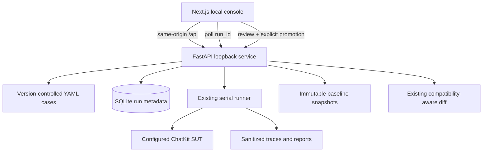

# P9 Web Console Flow

1. Dashboard loads safe settings, recent runs, cases and reviewed baselines. The SUT page can persist URL, revision, timeout and execution mode overrides locally; credentials stay outside the browser.
2. The user chooses the complete case set or a subset, plus a fail-on threshold.
3. API returns a queued run ID immediately. The single-user service executes serially in its background task and persists status.
4. UI polls status, opens report evidence and requests individual sanitized traces. JSON/Markdown reports are downloadable.
5. A reviewer may compare a completed run to a named baseline. Promotion is a separate explicit action requiring a review reason and never overwrites an existing name.

The interface provides loading, empty, request-error, SUT-connectivity, active-run, incomplete-trace and completed-result states. Mobile navigation is compact; case and run data remain read-only in the UI.
